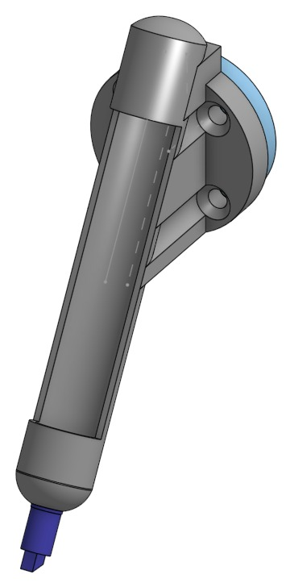
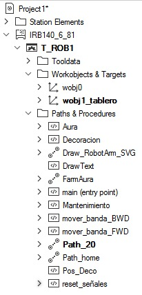
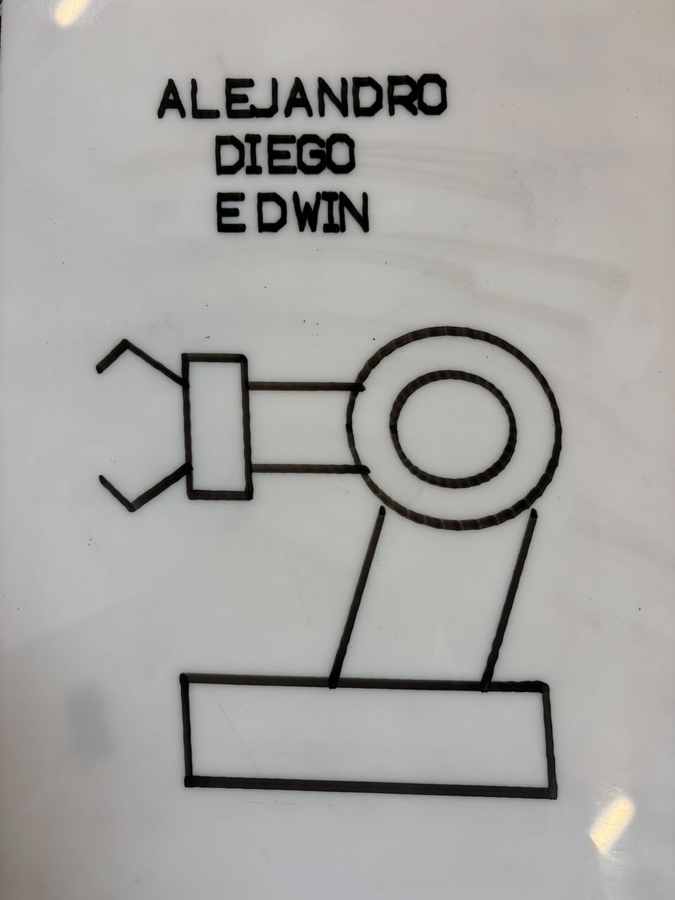

# 🤖 Laboratorio de Robótica: Robótica Industrial – Trayectorias, Entradas y Salidas Digitales

**Asignatura:** Robótica
**Fecha de entrega:** 29 de octubre de 2026  

---

## 📑 Tabla de Contenidos
1. [Descripción de la Solución](#1-descripción-de-la-solución)
2. [Layout y Plano de Planta](#2-layout-y-plano-de-planta)
3. [Diagrama de Flujo del Sistema](#3-diagrama-de-flujo-del-sistema)
4. [Diseño y Modelado de la Herramienta](#4-diseño-y-modelado-de-la-herramienta)
5. [Calibración de la Herramienta](#5-calibración-de-la-herramienta)
6. [Modelado del pastel](#6-modelado-geométrico-del-pastel-y-trayectorias)
7. [Programacion en rapid](#7-programación-en-rapid)
8. [Logica de control](#8-lógica-de-control-entradassalidas-digitales-y-máquina-de-estados)
9. [Codigo Fuente](#9-código-fuente)
10. [Conclusiones](#10-conclusiones)

---

## 1. Descripción de la Solución
**Objetivo Principal:**  
Automatizar un proceso de decoración de tortas (aplicado a la industria de alimentos) mediante el seguimiento controlado de trayectorias con un robot ABB IRB 140, integrando una banda transportadora y lógica de control basada en Entradas y Salidas Digitales (I/O).

**Estrategia Implementada:**  
Se diseñó una celda de trabajo donde la banda transporta una "torta virtual" hacia el robot. El sistema opera bajo un ciclo principal (`WHILE TRUE`) que monitorea tres entradas digitales (DI 01, DI 02, DI 03) para ejecutar distintas rutinas:
1. **Ciclo Automático (DI 01):** Transporte, decoración con nombres y figura libre, y evacuación del pastel.
2. **Pose de Mantenimiento (DI 02):** Posición segura para cambio de herramienta/marcador.
3. **Rutina "Farmear Aura" (DI 03):** Coreografía creativa del robot utilizando estructuras intermedias.

### Durante la implementación se aprendio a controlar la banda transportadora con FWD y BWD Conveyor.
---

## 2. Layout y Plano de Planta

A continuación, se presenta el plano de planta que indica la ubicación exacta de los elementos en el espacio de trabajo:

- **Robot ABB:** ABB 140 + Herramienta (Portamarcador)
- **Banda transportadora:** Controlada bidireccionalmente (`FWD Conveyor` / `BWD Conveyor`), con función principal de llevar el "pastel" a una posición deseada.
- **Superficies de trabajo:** "Pastel", basicamente es un tablero colocado para cumplir función de lugar de dibujo.
- **Herramienta (TCP):** Soporte con marcador fijado al flange del robot.


*(Figura 1: Layout de la planta de la celda de trabajo)*

---

## 3. Diagrama de Flujo del Sistema

El siguiente diagrama de flujo ilustra la secuencia completa de operaciones del sistema, desde el inicio del ciclo hasta la finalización de la tarea:


```
                         +-----------------------+
                         |      INICIO (main)    |
                         +-----------------------+
                                     |
                                     v
                         +-----------------------+
                         | Ir a Posición HOME    |
                         +-----------------------+
                                     |
                                     v
                       /---------------------------\
                      /  Evaluar Señales DI_01/02/03   \
                      \         (WHILE TRUE)        /
                       \---------------------------/ 
                         /           |           \
              DI_01             DI_02           DI_03
             /                       |                       \
            v                        v                        v             v
  +-------------------+    +-------------------+    farmear aura+-------------------+
  | MODO DECORADO     |    | MODO MANTENIMIENTO|    |    |
  | - DO_01 = 1       |    | - DO_02 = 1       |    | - Mueve a P_Apoyo |
  | - Avanza Banda    |    | - |    +-------------------+
  | - Ejecuta Paths   |    +-------------------+
  | - Evacua Torta    |
  +-------------------+
            \                        |                        /
             \                       |                       /
              +----------------------+----------------------+
                                     |
                                     v
                         +-----------------------+
                         | Retorno a HOME        |
                         +-----------------------+
```

---

**Descripción de las etapas principales:**
1. **[DI_02, Pose de mantenimiento]:** ...
2. **[DI_01, Decoración]:** ...
3. **[DI_03, Farmear Aura]:** ...

---

## 4. Diseño y Modelado de la Herramienta
### 4.1. Diseño Detallado

La herramienta porta-marcador fue modelada en software CAD (**Onshape**) y fabricada mediante fabricación aditiva en polímeros termoplásticos (**PLA**). Para garantizar la integridad del mecanismo y la calidad del trazo, el diseño cumple con las siguientes características:
* **Montaje:** Acople directo a la brida (*flange*) estándar del robot ABB IRB 140 mediante tornillos M6 .
* **Sistema de toleranacia Mecánica (Z):** Incorpora un mecanismo de amortiguación longitudinal basado en un resorte de compresión o elemento elástico que permite un recorrido pasivo en el eje Z de **8 mm max**. Esto absorbe errores de tolerancia en la altura de la torta y previene sobrecargas mecánicas en el manipulador.
* **Recambio Rápido:** Sistema de fijación del marcador por ajuste a presión del resorte tipo cartucho para el modo mantenimiento


| Parámetro Mecánico | Valor / Descripción |
| :--- | :--- |
| **Material de Impresión** | PLA |
| **Masa Total de la Herramienta ($m$)** | 0.28 KG |
| **Centro de Masa ($X_g, Y_g, Z_g$)($mm$)** |  0 , -18.75 , -7.71   |
| **Porcentaje de Relleno** | 15% |

### 4.2. Modelo CAD
A continuación, se muestra el modelo CAD de la herramienta desarrollada:


*(Figura 3: Modelo CAD de la herramienta / Tool)*


---

## 5. Calibración de la Herramienta

La punta de la herramienta  se calibró físicamente mediante el **método de 4 puntos** aproximando la punta del marcador a una referencia fija desde distintas orientaciones del robot.

* **Parámetros Obtenidos de `tooldata`:**
```rapid
PERS tooldata dfernandSim:=[TRUE,[[100.312,-2,94.461],[0.866025404,0,0.5,0]],[1,[0,0,1],[1,0,0,0],0,0,0]];
```


**Análisis de la comparación:**

### Análisis de Desviaciones entre Simulación y Realidad
| Medida | Valor en RobotStudio | Valor Real | Error / Desviación |
| :--- | :--- | :--- | :--- |
| **Error de Posicionamiento TCP** | 0.0 mm | `3.41mm` | `3.41mm` |
| **Desviación Z del WorkObject** | 0.0 mm | `2 mm` | Compensado por resorte |

---

## 6. Modelado Geométrico del Pastel y Trayectorias

### 6.1 Distribución Espacial sobre la Torta
El espacio de trabajo se define sobre la cara superior plana de la torta. Las trayectorias se programaron de forma plana (2D) sobre el plano XY del `wobjdata`, utilizando movimientos en el eje Z únicamente para la aproximación, contacto de escritura y retiro seguro de la herramienta.

```
       +---------------------------------------------------+
       |                                                   |
       |  [ DISTRIBUCIÓN GRÁFICA  DE LA TORTA / PLANO XY]       |
       |                                                   |
       |  Línea 1: [NOMBRE 1]                              |
       |  Línea 2: [NOMBRE 2]                              |
       |  Línea 3: [NOMBRE 3]                              |
       |  Área Lateral: [FIGURA DECORATIVA]               |
       |                                                   |
       +---------------------------------------------------+
```

### 6.2 Parámetros de Movimiento Seleccionados
* **Velocidad de Traslado :** `v200`  (200 mm/s)
* **Velocidad de Escritura/Contacto:** `v10`( 10 mm/s)
* **Zonas de Tolerancia (Precision):** `fine` en puntos de inicio/fin de trazo y esquinas agudas; `z1` a `z10` en trazos curvilíneos continuos.
* **Altura de Altitud Segura ($Z_{safe}$):** ` 10 mm sobre la superficie`
* **Altura de Contacto/Impresión ($Z_{write}$):** `-0.2 mm sobre la superficie`

## 7. Programación en RAPID
### 7.1. Instrucciones y Funciones Utilizadas


| Instrucción / Función | Descripción y uso en la práctica |
| :--- | :--- |
| `MoveJ` / `MoveL` | [Ej. Usado para aproximar a la pieza / para soldar o trazar] |
| `TriggL` | [Ej. Usado para activar la pinza en un punto exacto de la trayectoria] |
| `WaitDI` | [Ej. Usado para esperar a que la banda transportadora posicione la pieza] |



*(Figura : operaciones en RobotStudio)*


---

## 8. Lógica de Control, Entradas/Salidas Digitales y Máquina de Estados

### 8.1 Mapeo de Señales Digitales (I/O)
La integración entre el controlador **IRC5**, la banda transportadora y los periféricos de la celda se realiza mediante el tablero de E/S discretas configuradas de acuerdo al estándar de la práctica:

| Señal | Tipo | Descripción y Función en el Proceso |
| :--- | :--- | :--- |
| **`DI_01`** | Entrada Digital | **Modo Decorado Nominal:** Inicia el avance de la banda, espera posicionamiento y ejecuta el ciclo de trazado completo. |
| **`DI_02`** | Entrada Digital | **Modo Mantenimiento:** Envía el robot a posición segura para cambio de marcador o inspección. |
| **`DI_03`** | Entrada Digital | **Farmear aura:** Activa el modo farmear aura con las especificaciones requeridas|
| **`DO_01`** | Salida Digital | **Indicador Operación Nominal:** Luz o baliza activada durante la ejecución del decorado. |
| **`DO_02`** | Salida Digital | **Indicador Mantenimiento:** Luz o baliza activada cuando el robot está en mantenimiento. |
| **`DO_03`** | Salida Digital | **Farmear aura:** Baliza indicadora del modo farmear aura |


---

## 9. Código Fuente

El programa en RAPID se organizó de forma modular , separando la declaración de datos, las subrutinas de movimiento de cada palabra/figura y el bucle principal de control.
 

## 9. Resultados

* **Dimensiones del dibujo en la Torta:** `250mm x 200mm`
* **Nombres a Trazar:** `ALEJANDRO , EDWIN, DIEGO`
* **Figura Decorativa Elegida:** `Robot Abb`

*(Figura 4: Dibujo en la torta)*


## 10. Conclusiones

1. La implementación de un mecanismo pasivo de complianza mediante resorte en el efector final demostró ser fundamental para compensar las diferencias de altura y tolerancias superficiales entre el entorno virtual de RobotStudio y la celda física real.
2. La definición precisa del `wobjdata` mediante el método de 3 puntos permitió que las trayectorias de escritura fueran totalmente independientes de la posición absoluta del manipulador, facilitando el reajuste rápido del proceso ante desplazamientos de la banda transportadora.
3. La arquitectura modular del código RAPID y la implementación de una máquina de estados controlada por Entradas Digitales (`DI_01`, `DI_02`) garantizaron un flujo de trabajo seguro, permitiendo alternar de forma confiable entre la operación nominal de decorado y las tareas de mantenimiento.


