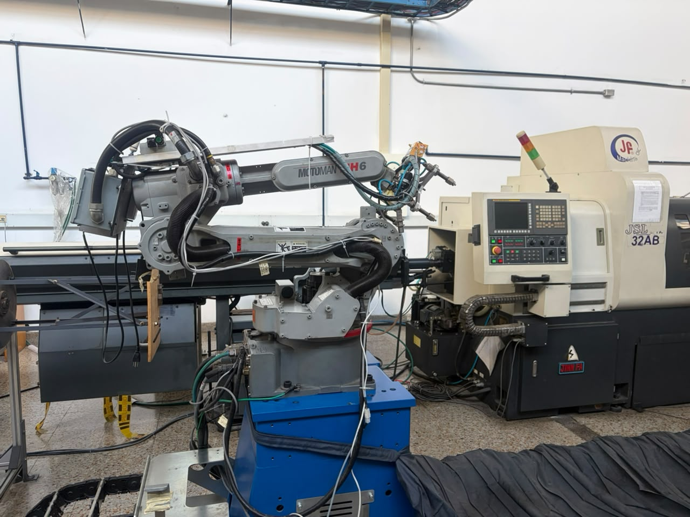
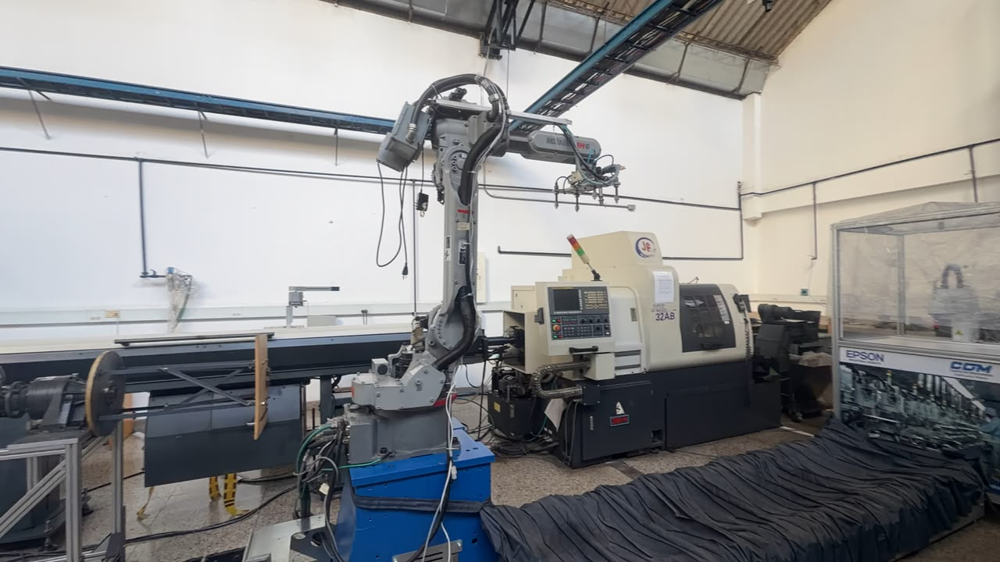
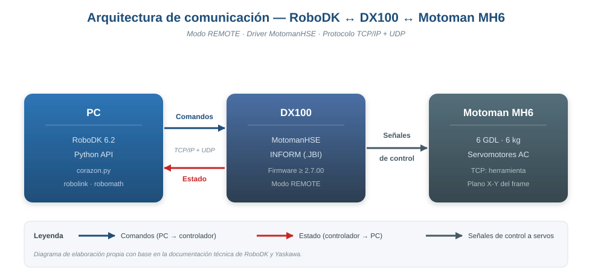
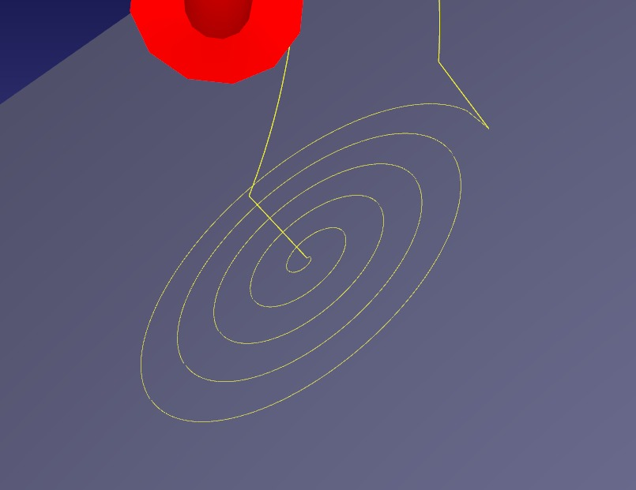
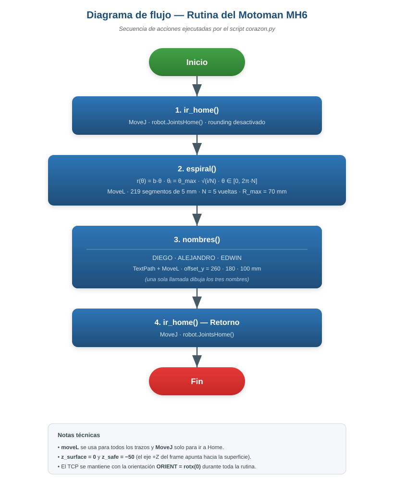
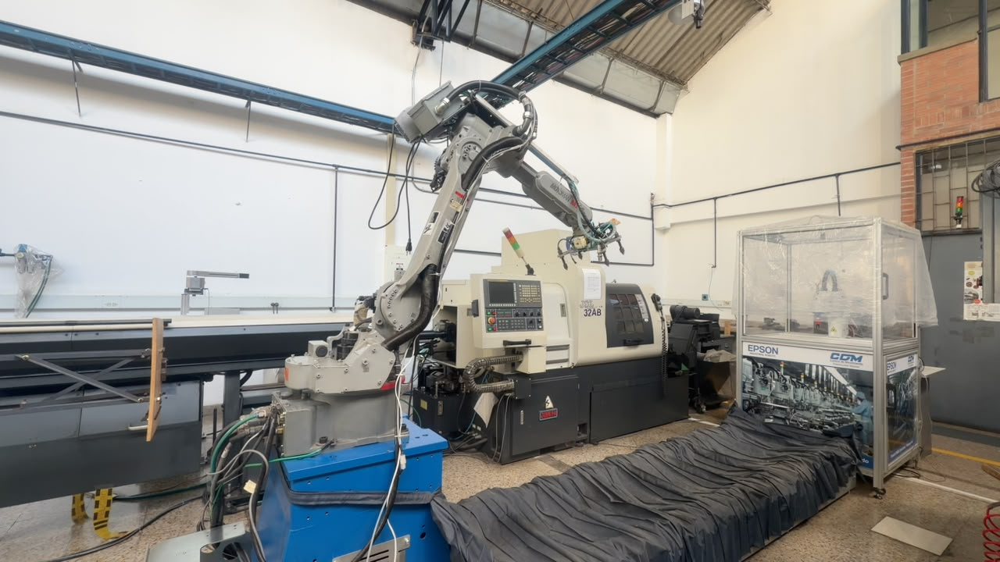

# Laboratorio No. 02 — Robótica Industrial

## Análisis y operación del manipulador Motoman MH6

**Universidad Nacional de Colombia** · Robótica (2016770) 2026-2

<p align="center">
  
  <br>
  <em><strong>Figura 1.</strong> Manipulador Motoman MH6, integrado a la celda de trabajo.</em>
</p>

---

## Tabla de contenido

1. [Resumen](#1-resumen)
2. [Cuadro comparativo Motoman MH6 vs. ABB IRB 140](#2-cuadro-comparativo-motoman-mh6-vs-abb-irb-140)
3. [Configuraciones Home1 y Home2](#3-configuraciones-home1-y-home2)
4. [Operación manual del manipulador](#4-operación-manual-del-manipulador)
5. [Niveles de velocidad manual](#5-niveles-de-velocidad-manual)
6. [RoboDK: funcionalidades y comunicación](#6-robodk-funcionalidades-y-comunicación)
7. [Comparación RoboDK vs. RobotStudio](#7-comparación-robodk-vs-robotstudio)
8. [Trayectoria polar implementada](#8-trayectoria-polar-implementada)
9. [Diagrama de flujo de la rutina](#9-diagrama-de-flujo-de-la-rutina)
10. [Plano de planta](#10-plano-de-planta)
11. [Código y video](#11-código-y-video)
12. [Conclusiones](#12-conclusiones)
13. [Referencias](#13-referencias)

---

## 1. Resumen

En esta práctica se operó y programó de forma manual y remota el manipulador industrial **Yaskawa Motoman MH6** del Laboratorio de Sistemas Inteligentes y Robótica (LabSIR) mediante el software **RoboDK 6.2** y su API de Python. Se realizó una caracterización comparativa con el **ABB IRB 140**, se identificaron las dos configuraciones Home del controlador **DX100**, los cuatro niveles de velocidad manual y los modos de movimiento disponibles. Como producto final se diseñó e implementó una rutina que combina una **espiral de Arquímedes** con la escritura de los nombres del equipo mediante trazos vectoriales, validada primero en simulación y posteriormente ejecutada en el robot físico bajo supervisión del laboratorio.

---

## 2. Cuadro comparativo Motoman MH6 vs. ABB IRB 140

Ambos son manipuladores seriales antropomórficos de **6 GDL** y **6 kg** de carga útil, pero con compromisos de diseño opuestos: el MH6 privilegia el **alcance**, mientras que el IRB 140 privilegia la **precisión y la compacidad**. Los datos provienen de los manuales de fabricante (_MOTOMAN-MH6 Instructions_ HW0484977 e _IRB 140 Product Specification_ 3HAC041346-001) y se agrupan por categoría en las Tablas 1–4.

**Tabla 1.** _Características generales._

| Característica                   | Yaskawa Motoman MH6                                                         | ABB IRB 140                                                              |
| -------------------------------- | --------------------------------------------------------------------------- | ------------------------------------------------------------------------ |
| Fabricante                       | Yaskawa Motoman                                                             | ABB Robotics                                                             |
| Configuración mecánica           | Articulada antropomórfica, 6 GDL                                            | Articulada antropomórfica, 6 GDL                                         |
| Carga útil máxima                | 6 kg                                                                        | 6 kg                                                                     |
| Alcance horizontal máximo        | ≈ 1422 mm                                                                   | ≈ 810 mm (hasta eje 5)                                                   |
| Alcance vertical máximo          | ≈ 2486 mm                                                                   | Depende de la configuración                                              |
| Repetibilidad de posicionamiento | ±0.08 mm (ISO 9283)                                                         | ±0.03 mm                                                                 |
| Masa aproximada                  | ≈ 130 kg                                                                    | ≈ 98 kg                                                                  |
| Sistema de accionamiento         | Servomotores AC                                                             | Servomotores AC                                                          |
| Montaje                          | Piso, pared, techo                                                          | Piso, pared, techo, inclinado                                            |
| Aplicaciones típicas             | Manipulación, atención de máquinas, soldadura, ensamble y paletizado ligero | Ensamble fino, _pick & place_, laboratorio, empaque y espacios reducidos |

**Tabla 2.** _Velocidades articulares máximas_ (°/s).

|         Articulación          | Yaskawa Motoman MH6 | ABB IRB 140 |
| :---------------------------: | :-----------------: | :---------: |
|        Eje 1 (base, S)        |         220         |     200     |
|       Eje 2 (hombro, L)       |         200         |     200     |
|        Eje 3 (codo, U)        |         220         |     260     |
|    Eje 4 (giro muñeca, R)     |         410         |     360     |
| Eje 5 (inclinación muñeca, B) |         410         |     360     |
|     Eje 6 (giro final, T)     |         610         |     450     |

**Tabla 3.** _Rangos de movimiento articular._

| Articulación | Yaskawa Motoman MH6 | ABB IRB 140                    |
| :----------: | ------------------- | ------------------------------ |
|    Eje 1     | ±170°               | ±180° (recorrido 360°)         |
|    Eje 2     | +155° / −90°        | +110° / −90°                   |
|    Eje 3     | +250° / −175°       | +50° / −230°                   |
|    Eje 4     | ±180°               | Rotación continua configurable |
|    Eje 5     | +225° / −45°        | ±115°                          |
|    Eje 6     | ±360°               | Rotación continua configurable |

**Tabla 4.** _Sistemas de control y programación._

| Aspecto                             | Yaskawa Motoman MH6             | ABB IRB 140          |
| ----------------------------------- | ------------------------------- | -------------------- |
| Controlador                         | DX100 (también DX200 / YRC1000) | IRC5                 |
| Lenguaje nativo                     | INFORM (`.JBI`)                 | RAPID (`.mod`)       |
| Interfaz de programación            | Teach Pendant Motoman           | FlexPendant ABB      |
| Instrucción de movimiento articular | `MOVJ`                          | `MoveAbsJ` / `MoveJ` |
| Instrucción de movimiento lineal    | `MOVL`                          | `MoveL`              |
| Instrucción de movimiento circular  | `MOVC`                          | `MoveC`              |
| Simulador asociado                  | MotoSim / RoboDK                | RobotStudio / RoboDK |

**Análisis comparativo.** Ambos manipuladores comparten carga útil (6 kg) y configuración antropomórfica de 6 GDL, pero responden a compromisos de diseño distintos. El MH6 privilegia la cobertura espacial: alcanza 1422 mm, aproximadamente 76 % más que los 810 mm del IRB 140, a costa de mayor masa (130 kg frente a 98 kg) y menor repetibilidad (±0.08 mm frente a ±0.03 mm). En velocidad angular, el MH6 supera al IRB 140 en los ejes 1, 4, 5 y 6; el IRB 140 solo lo supera en el eje 3 (260 frente a 220 °/s). Puesto que cada fabricante emplea un lenguaje propietario (INFORM y RAPID), herramientas como RoboDK resultan pertinentes como capa unificada de programación. En síntesis, el MH6 se ajusta mejor a celdas amplias con múltiples estaciones, mientras que el IRB 140 se prefiere en tareas finas de alta precisión en espacios reducidos.

---

## 3. Configuraciones Home1 y Home2

El controlador DX100 del Motoman MH6 gestiona dos configuraciones Home con propósitos complementarios: **Home1**, asociada a la postura compacta de referencia y transporte, y **Home2**, asociada a la postura desplegada de operación.

<table>
  <tr>
    <td align="center" width="50%">
      <br>
      <em><strong>Figura 2a.</strong> Configuración <code>Home1</code>: postura compacta del manipulador.</em>
    </td>
    <td align="center" width="50%">
      <br>
      <em><strong>Figura 2b.</strong> Configuración <code>Home2</code>: postura desplegada del manipulador.</em>
    </td>
  </tr>
</table>

Las posiciones articulares se registraron directamente en la pantalla **`WORK HOME POSITION`** del teach pendant, donde el controlador presenta, para el robot R1, la posición home de trabajo (`ORIGIN`) y la posición instantánea (`CURRENT`) de cada eje, expresadas en pulsos del encoder.

<table>
  <tr>
    <td align="center" width="50%">
      <br>
      <em><strong>Figura 2c.</strong> Pantalla <code>WORK HOME POSITION</code> del teach pendant: columna <code>ORIGIN</code>, que almacena la posición home de trabajo configurada en el controlador para el robot R1.</em>
    </td>
    <td align="center" width="50%">
      <br>
      <em><strong>Figura 2d.</strong> Pantalla <code>WORK HOME POSITION</code> del teach pendant: columna <code>CURRENT</code>, que reporta la posición instantánea del robot en el momento de la lectura.</em>
    </td>
  </tr>
</table>

En la lectura registrada, los valores de `ORIGIN` y `CURRENT` coinciden en todos los ejes, lo que confirma que el robot se encontraba exactamente en la posición home de trabajo al momento de tomar la fotografía.

**Tabla 5.** _Posiciones articulares de las configuraciones Home del Motoman MH6._ Lectura directa del teach pendant, en pulsos del encoder.

|   Configuración    | S (base) | L (hombro) | U (codo) | R (giro muñeca) | B (inclinación muñeca) | T (giro final) |
| :----------------: | :------: | :--------: | :------: | :-------------: | :--------------------: | :------------: |
| **Home1** (pulsos) |    0     |  −115290   | −111622  |        1        |         42647          |      1392      |
| **Home2** (pulsos) |    0     |    2037    |   2359   |        0        |          −121          |      1392      |

> **Nota.** Los valores corresponden a pulsos del encoder. Para expresarlos en grados debe aplicarse el factor pulsos/grado indicado en el manual del MH6.

Ninguna de las dos configuraciones es universalmente superior: cada una responde a una necesidad operativa distinta. **Home1** minimiza el volumen ocupado y el riesgo de colisión, por lo que resulta preferible para transporte, almacenamiento y reposo prolongado. **Home2** deja el brazo cerca del espacio de trabajo y es preferible como posición inicial de operación. En cualquier caso, ninguna de las dos garantiza por sí sola la ausencia de colisiones: la seguridad de una trayectoria debe evaluarse según las condiciones del entorno y el programa que se ejecutará.

---

## 4. Operación manual del manipulador

### 4.1 Preparación y habilitación

Para ejecutar cualquier movimiento manual, el operador debe:

1. Verificar que el área de trabajo esté libre de personas y obstáculos.
2. Energizar los _breakers_ MOTOMAN y el _breaker_ totalizador.
3. Encender el controlador DX100 girando la perilla 90° en sentido horario.
4. Colocar el selector físico **MODE** del pendant en **TEACH**.
5. Verificar que no existan alarmas activas y liberar el paro de emergencia (giro horario).
6. Presionar **[SERVO ON READY]**.
7. Mantener el _enable switch_ (hombre muerto) en su posición intermedia durante el movimiento.
8. Iniciar con velocidad baja mediante **[SLOW]**.

> El selector **TEACH / PLAY / REMOTE** define el modo general del controlador; la tecla **[COORD]** (independiente) define cómo se interpreta el movimiento manual dentro del modo TEACH.

### 4.2 Selección del sistema de coordenadas `[COORD]`

Cada pulsación de **[COORD]** alterna el modo activo en la barra de estado del pendant. El modo activo se refleja en el ícono del área de estado.

**Tabla 6.** _Sistemas de coordenadas disponibles para el movimiento manual._

| Modo                     | Teclas                             | Efecto                                                |
| ------------------------ | ---------------------------------- | ----------------------------------------------------- |
| **JOINT**                | `S±`, `L±`, `U±`, `R±`, `B±`, `T±` | Mueve cada articulación de forma independiente        |
| **CARTESIAN**            | `X±`, `Y±`, `Z±`                   | Traslada el TCP en el sistema del robot               |
| **CARTESIAN (rotación)** | `R`, `B`, `T`                      | Rota la herramienta alrededor de X, Y, Z (Rx, Ry, Rz) |
| **TOOL**                 | `X±`, `Y±`, `Z±`                   | Movimiento respecto a los ejes de la herramienta      |
| **USER**                 | `X±`, `Y±`, `Z±`                   | Movimiento respecto a un _frame_ de usuario           |

### 4.3 Movimiento por articulaciones (JOINT)

Cada articulación se controla directamente con las teclas del pendant. Es el modo más directo y el recomendado durante la calibración y el ajuste fino.

**Tabla 7.** _Correspondencia entre articulación, función mecánica y teclas del pendant._

|   Articulación    | Función               |      Teclas       |
| :---------------: | --------------------- | :---------------: |
|  **S** (Swivel)   | Giro de la base       | `X−/S−` · `X+/S+` |
| **L** (Lower arm) | Brazo inferior        | `Y−/L−` · `Y+/L+` |
| **U** (Upper arm) | Brazo superior        | `Z−/U−` · `Z+/U+` |
|   **R** (Roll)    | Giro de muñeca        | `X−/R−` · `X+/R+` |
|   **B** (Bend)    | Inclinación de muñeca | `Y−/B−` · `Y+/B+` |
|   **T** (Twist)   | Giro del eje terminal | `Z−/T−` · `Z+/T+` |

**Procedimiento:**

1. Mantener el controlador en **TEACH**.
2. Pulsar **[COORD]** hasta visualizar el ícono de articulaciones.
3. Seleccionar nivel de velocidad (ver Sección 5).
4. Mantener presionado el _enable switch_.
5. Presionar la tecla del eje deseado en sentido (+) o (−).
6. Soltar la tecla para detener el movimiento.

### 4.4 Movimiento en coordenadas cartesianas (traslaciones y rotaciones en X, Y, Z)

El modo cartesiano permite desplazar el **TCP** en un sistema ortogonal, dejando que el controlador calcule la configuración articular equivalente (cinemática inversa).

**Tabla 8.** _Teclas para traslación y rotación del TCP en modo cartesiano._

|  Eje  | Traslación        | Rotación               |
| :---: | ----------------- | ---------------------- |
| **X** | `X+/S+` · `X−/S−` | `X+/R+` · `X−/R−` (Rx) |
| **Y** | `Y+/L+` · `Y−/L−` | `Y+/B+` · `Y−/B−` (Ry) |
| **Z** | `Z+/U+` · `Z−/U−` | `Z+/T+` · `Z−/T−` (Rz) |

> **Nota.** Aunque las teclas están rotuladas también con las articulaciones `R`, `B` y `T`, en modo cartesiano representan rotaciones alrededor de los ejes **X**, **Y** y **Z** del sistema de referencia activo. El sentido positivo se interpreta con la **regla de la mano derecha**.

**Procedimiento para cambiar de JOINT a CARTESIAN:**

1. Detener cualquier movimiento soltando las teclas.
2. Presionar **[COORD]** hasta seleccionar el ícono de coordenadas cartesianas.
3. Confirmar el ícono en la barra de estado del pendant.
4. Utilizar las teclas de traslación o rotación según la Tabla 8.

---

## 5. Niveles de velocidad manual

El controlador DX100 ofrece **cuatro niveles de velocidad** seleccionables con las teclas **[FAST]** (▲) y **[SLOW]** (▼). Cada pulsación de **[FAST]** asciende un nivel en la secuencia INCH → SLOW → MED → FAST; cada pulsación de **[SLOW]** la desciende en sentido inverso. Adicionalmente, mientras se mantiene una tecla de eje, la tecla **[HIGH SPEED]** hace que el robot se mueva más rápido que la velocidad seleccionada (esta función no opera en INCH). El cambio de nivel se refleja de inmediato en el indicador del área de estado del pendant, sin necesidad de mover el robot.

**Tabla 9.** _Niveles de velocidad manual del controlador DX100._

|   Nivel    | Indicador | Descripción                                             | Aplicación típica                       |
| :--------: | :-------: | ------------------------------------------------------- | --------------------------------------- |
|  **INCH**  |    `I`    | Movimiento incremental de corta distancia por pulsación | Ajustes finos de precisión              |
|  **SLOW**  |    `L`    | Movimiento continuo lento                               | Aproximación a obstáculos y piezas      |
| **MEDIUM** |    `M`    | Movimiento continuo intermedio                          | Posicionamiento general                 |
|  **FAST**  |    `H`    | Movimiento continuo rápido                              | Desplazamientos amplios en zonas libres |

El nivel activo se identifica en el **área de estado** del pendant mediante un ícono con **barras verdes crecientes** —similar al indicador de señal de un teléfono celular—: una barra indica la mínima velocidad y tres barras la máxima.

<p align="center">
  
  <br>
  <em><strong>Figura 3.</strong> Área de estado del controlador DX100 según la documentación del fabricante. El ícono de barras verdes crecientes corresponde al nivel de velocidad manual activo.</em>
</p>

---

## 6. RoboDK: funcionalidades y comunicación

### 6.1 Funcionalidades principales

RoboDK es un software de simulación y programación fuera de línea (_offline programming_) independiente del fabricante, que permite operar robots industriales de más de 50 marcas desde una única interfaz.

**Tabla 10.** _Funcionalidades de RoboDK empleadas en la práctica._

| Categoría        | Función                                                                                    |
| ---------------- | ------------------------------------------------------------------------------------------ |
| Simulación 3D    | Representación del robot, herramienta y celda con detección de colisiones y singularidades |
| Programación OLP | Generación de programas nativos mediante post-procesadores (`.JBI` para Motoman)           |
| API Python       | Automatización de trayectorias con `robolink` y `robomath`                                 |
| Cinemática       | Cálculo de cinemática directa e inversa; calibración de TCP y _frames_                     |
| Control remoto   | Ejecución en línea (_Run on robot_) mediante el driver **MotomanHSE**                      |
| Importación CAD  | Construcción de entornos de trabajo realistas                                              |

### 6.2 ¿Qué hace RoboDK para mover el manipulador?

RoboDK ejecuta internamente cuatro etapas para transformar una instrucción de alto nivel en movimiento físico:

1. **Cinemática inversa.** Convierte cada objetivo (posición + orientación del TCP) en la configuración articular equivalente.
2. **Planificación de trayectoria.** Genera los segmentos `MoveJ` (articulares) y `MoveL` (lineales) entre objetivos, respetando los límites del robot.
3. **Verificación.** Detecta colisiones y singularidades antes de enviar el programa al robot real.
4. **Ejecución.** Según el modo elegido, o bien **genera un archivo `.JBI`** que se transfiere al controlador (offline), o bien **envía los comandos en tiempo real** mediante el driver (online).

### 6.3 ¿Cómo se comunica RoboDK con el manipulador?

La comunicación se realiza a través del controlador **DX100**, que interpreta las instrucciones y gobierna los servomotores del robot. RoboDK dispone de dos mecanismos:

**Tabla 11.** _Modos de comunicación entre RoboDK y el Motoman MH6._

| Característica            | Programación offline               | Programación online                    |
| ------------------------- | ---------------------------------- | -------------------------------------- |
| Herramienta principal     | Post-procesador                    | Driver **MotomanHSE**                  |
| Protocolo                 | FTP o USB para transferir `.JBI`   | Ethernet (TCP/IP + UDP), protocolo HSE |
| Archivo generado          | `.JBI` (INFORM)                    | No requiere archivo previo             |
| Requisito del controlador | Almacenar y ejecutar el programa   | Firmware ≥ 2.7.00 · Modo REMOTE        |
| Aplicación principal      | Rutinas predefinidas y repetitivas | Pruebas, depuración y control remoto   |

La arquitectura de la comunicación se ilustra en la Figura 4.

<p align="center">
  
  <br>
  <em><strong>Figura 4.</strong> Arquitectura de comunicación entre RoboDK, el controlador DX100 y el Motoman MH6. Elaboración propia con base en la documentación técnica de RoboDK y Yaskawa.</em>
</p>

### 6.4 Conexión efectiva en el laboratorio

En el script la conexión directa está **comentada**; la habilitación efectiva se realizó desde la GUI de RoboDK (**Connect → Connect to Robot → MotomanHSE → IP del controlador**), con el pendant en modo **REMOTE**.

```python
#------------------------------------------------
# 1) Conexión a RoboDK e inicialización
#------------------------------------------------
RDK = Robolink()

# Elegir un robot (si hay varios, aparece un popup)
robot = RDK.ItemUserPick("Selecciona un robot", ITEM_TYPE_ROBOT)
if not robot.Valid():
    raise Exception("No se ha seleccionado un robot válido.")

# Conectar al robot físico (comentado: se hizo desde la GUI de RoboDK)
# if not robot.Connect():
#     raise Exception("No se pudo conectar al robot. Verifica que esté en modo remoto.")
# if not robot.ConnectedState():
#     raise Exception("El robot no está conectado correctamente.")

print("Robot conectado correctamente.")
```

---

## 7. Comparación RoboDK vs. RobotStudio

**Tabla 12.** _Comparación entre RoboDK y RobotStudio._

| Aspecto                   | RoboDK                                                       | RobotStudio                                    |
| ------------------------- | ------------------------------------------------------------ | ---------------------------------------------- |
| Fabricante                | RoboDK Inc. (independiente)                                  | ABB Robotics                                   |
| Marcas soportadas         | Multimarca (>50 fabricantes: Yaskawa, ABB, FANUC, KUKA, UR…) | Solo ABB                                       |
| Lenguaje                  | Python / C# / C++ / MATLAB vía API + post-procesador         | RAPID (nativo)                                 |
| Simulación                | Cinemática, colisiones, alcance                              | Controlador virtual ABB (_Virtual Controller_) |
| Comunicación con el robot | Drivers por fabricante (MotomanHSE para Yaskawa)             | Conexión nativa al IRC5                        |
| Curva de aprendizaje      | Baja–media                                                   | Media–alta                                     |
| Costo                     | Licencia comercial con versión de prueba                     | Gratuito para simulación básica                |

### 7.1 Ventajas y limitaciones

**RoboDK**

- **Ventajas.** Flexibilidad multimarca, API en Python, curva de aprendizaje corta, control remoto del robot real.
- **Limitaciones.** No replica internamente el controlador de cada fabricante; la fidelidad de los tiempos de ciclo depende del post-procesador y del driver.

**RobotStudio**

- **Ventajas.** Alta fidelidad gracias al _Virtual Controller_ que ejecuta el mismo software que el IRC5 real; integración total con el ecosistema ABB y sus _Smart Components_.
- **Limitaciones.** Solo opera con robots ABB y su uso es más exigente en recursos.

### 7.2 Usos específicos y reflexión del equipo

- **RoboDK.** Programación _offline_ multimarca, prototipado rápido y control remoto desde Python — como en este laboratorio con el Motoman MH6.
- **RobotStudio.** Validación de celdas ABB y programas RAPID antes de la puesta en marcha — como en el Laboratorio 01 con el IRB 140.

**Reflexión del equipo.** RoboDK resultó más intuitivo para la creación de trayectorias y su integración con Python permitió parametrizar movimientos y generar curvas mediante expresiones matemáticas. RobotStudio se percibió como una herramienta más completa y especializada, con una curva de aprendizaje mayor pero con un entorno más estructurado para coordinar dispositivos ABB. En conjunto se complementan: RobotStudio aporta **fidelidad**, RoboDK aporta **versatilidad**.

---

## 8. Trayectoria polar implementada

### 8.1 Descripción general

La rutina del equipo combina tres etapas ejecutadas en secuencia sobre el _frame_ `Frame_from_Target1` del robot:

1. **Espiral de Arquímedes** parametrizada como `r(θ) = b·θ`.
2. **Escritura de los nombres del equipo** — _DIEGO_, _ALEJANDRO_, _EDWIN_ — mediante trazos vectoriales generados con `matplotlib.textpath.TextPath`.
3. **Retorno a la posición Home** al finalizar.

Todos los trazos se ejecutan con `MoveL` sobre el plano del _frame_ (`z_surface = 0`), usando una altura segura `z_safe = −50` (el eje +Z del _frame_ apunta hacia la superficie, por lo que "subir" equivale a valores negativos).

<p align="center">
  
  <br>
  <em><strong>Figura 5.</strong> Espiral de Arquímedes generada por la rutina: 5 vueltas, 70 mm de radio máximo. Captura de simulación en RoboDK.</em>
</p>

### 8.2 Parámetros de la trayectoria

**Tabla 13.** _Parámetros de la trayectoria implementada en el script._

| Parámetro    |           Valor           | Observación                                       |
| ------------ | :-----------------------: | ------------------------------------------------- |
| `turns`      |             5             | Número de vueltas de la espiral                   |
| `R_max`      |           70 mm           | Radio máximo (alcance medido de la celda: 140 mm) |
| `seg_len`    |           5 mm            | Longitud de cada segmento `MoveL`                 |
| `b`          |       ≈ 2.23 mm/rad       | `R_max / (2π·turns)`                              |
| `num_points` |            219            | Número de puntos generados                        |
| `z_surface`  |           0 mm            | Plano de trabajo del _frame_                      |
| `z_safe`     |          −50 mm           | Altura de desplazamiento entre trazos             |
| `ORIENT`     |         `rotx(0)`         | Orientación identidad del TCP                     |
| Velocidad    |         300 mm/s          | `robot.setSpeed(300)`                             |
| Blending     |           5 mm            | `robot.setRounding(5)`                            |
| Nombres      | DIEGO · ALEJANDRO · EDWIN | Generados con `TextPath`                          |

### 8.3 Generación de la espiral

La espiral se construye en coordenadas polares y se convierte a cartesianas. El parámetro θ se muestrea con `θᵢ = θ_max · √(i/N)` para obtener **longitud de arco aproximadamente uniforme** (en la espiral de Arquímedes `ds ∝ θ·dθ`, de modo que un muestreo lineal en θ concentraría puntos en el centro).

**Fragmento 1.** _Generación de la espiral de Arquímedes con muestreo por longitud de arco uniforme._

```python
def pose(x, y, z):
    return transl(x, y, z) * ORIENT

def espiral():
    robot.setRounding(1)                    # suavizado para trazo continuo
    for i in range(1, num_points + 1):
        theta = theta_max * math.sqrt(i / num_points)   # θᵢ ∝ √i
        r = b * theta
        x = r * math.cos(theta)
        y = r * math.sin(theta)
        robot.MoveL(pose(x, y, z_surface))

    robot.setRounding(-1)                   # desactiva blending antes de subir
    robot.MoveL(pose(x, y, z_surface + z_safe))
```

### 8.4 Escritura de los nombres

Para cada carácter se obtiene su contorno con `TextPath` y se recorre el arreglo de vértices de `matplotlib.path.Path`. Cada código `MOVETO` implica un levantamiento del TCP y un descenso; los `LINETO`, `CURVE3` y `CURVE4` se aproximan con `MoveL` (por lo que las curvas quedan poligonales).

**Fragmento 2.** _Escritura de los nombres del equipo con TextPath (patrón repetido para los tres nombres)._

```python
def nombres():
    text            = "DIEGO"
    scale           = 1.5
    letter_spacing  = 50
    text_offset_x   = -150
    text_offset_y   = 260
    x_cursor        = text_offset_x

    for char in text:
        tp    = TextPath((0, 0), char, size=50)
        verts = tp.vertices * scale
        codes = tp.codes
        last_x, last_y = None, None

        for (vx, vy), code in zip(verts, codes):
            x_pos = x_cursor + vx
            y_pos = text_offset_y + vy

            if code == Path.MOVETO:
                robot.MoveL(transl(y_pos, x_pos, z_safe))       # pluma arriba
                robot.MoveL(transl(y_pos, x_pos, z_surface))    # baja a superficie
            elif code in (Path.LINETO, Path.CURVE3, Path.CURVE4):
                robot.MoveL(transl(y_pos, x_pos, z_surface))    # traza

            last_x, last_y = x_pos, y_pos

        # sube el TCP al terminar la letra
        if last_x is not None and last_y is not None:
            robot.MoveL(transl(last_y, last_x, z_safe))
        x_cursor += letter_spacing

    # el mismo bloque se repite para "ALEJANDRO" y "EDWIN",
    # desplazando text_offset_y en 80 mm hacia abajo en cada iteración
```

> **Observación técnica.** Los nombres se dibujan con `transl(y_pos, x_pos, z)` — es decir, se intercambian X e Y — para alinear el texto con la orientación del _frame_ de trabajo. Adicionalmente, los vértices de control de las curvas Bézier se recorren como vértices rectos, por lo que las letras quedan aproximadas por segmentos `MoveL`.

### 8.5 Secuencia de ejecución

**Fragmento 3.** _Secuencia principal del script._

```python
ir_home()      # 1. ir a la posición Home
espiral()      # 2. dibujar espiral
nombres()      # 3. escribir DIEGO · ALEJANDRO · EDWIN
ir_home()      # 4. regresar a Home
```

---

## 9. Diagrama de flujo de la rutina

La Figura 6 presenta el diagrama de flujo de acciones del robot durante la rutina del equipo.

<p align="center">
  
  <br>
  <em><strong>Figura 6.</strong> Diagrama de flujo de la rutina ejecutada por el script <code>corazon.py</code>. Elaboración propia.</em>
</p>

---

## 10. Plano de planta

El entorno del laboratorio incluye, además del Motoman MH6, un torno CNC, un alimentador de barra y una celda Epson/CDM con cerramiento transparente.

<table>
  <tr>
    <td align="center" width="50%">
      <br>
      <em><strong>Figura 7.</strong> Motoman MH6 sobre base azul; al fondo, torno CNC y celda Epson/CDM.</em>
    </td>
  </tr>
</table>

**Tabla 14.** _Elementos identificados en la celda del laboratorio._

| Elemento             | Observación                                               |
| -------------------- | --------------------------------------------------------- |
| Motoman MH6          | Montado sobre base azul, con _energy chain_ hacia el piso |
| Herramienta          | Efector neumático con elementos de agarre en la muñeca    |
| Torno CNC            | Jinn Fa (JF) modelo `32AB` junto al robot                 |
| Alimentador de barra | Riel largo al costado izquierdo                           |
| Celda Epson / CDM    | Gabinete con cerramiento transparente al fondo            |
| Pendant              | Teach pendant del controlador DX100                       |

---

## 11. Código y video

### 11.1 Código fuente

El script completo se encuentra en la carpeta `code/` de este mismo repositorio:

- [`code/RosPolar.py`](./code/RosPolar.py)

**Tabla 15.** _Funciones principales del script._

| Función         | Propósito                                                            |
| --------------- | -------------------------------------------------------------------- |
| `ir_home()`     | `MoveJ` a `robot.JointsHome()` con blending desactivado              |
| `pose(x, y, z)` | Compone `transl(x, y, z) * ORIENT` para fijar posición y orientación |
| `espiral()`     | Genera y ejecuta la espiral de Arquímedes                            |
| `nombres()`     | Recorre los trazos de _DIEGO_, _ALEJANDRO_ y _EDWIN_ con `MoveL`     |

### 11.2 Videos

Los videos inician con la introducción oficial de LabSIR y muestran la simulación en RoboDK y la ejecución física en el Motoman MH6 controlado desde el PC.

| Recurso                               | Enlace            |
| ------------------------------------- | ----------------- |
| 🎥 Ejecución física en el Motoman MH6 | [Video](https://www.youtube.com/watch?v=iQOEZfHuUSo) |

---

## 12. Conclusiones

- La combinación **RoboDK + DX100** permitió programar el Motoman MH6 con una capa de abstracción en Python, sin depender del lenguaje INFORM para el desarrollo de trayectorias.
- La **espiral de Arquímedes** con muestreo `θᵢ ∝ √(i/N)` produjo una longitud de arco aproximadamente uniforme, lo que se traduce en una velocidad de trazo más consistente sobre la superficie.
- El uso de `matplotlib.textpath.TextPath` demuestra la flexibilidad de integrar librerías científicas de Python con la API de RoboDK; sin embargo, al aproximar las curvas Bézier con `MoveL`, la fidelidad tipográfica queda limitada por la resolución de la polilínea.
- Las **dos configuraciones Home** del MH6 cumplen funciones complementarias: transporte/almacenamiento (compacta) y operación (desplegada). Ninguna es universalmente superior.
- La **comparación MH6 vs. IRB 140** evidenció el compromiso de diseño entre alcance, precisión y masa: el MH6 maximiza cobertura; el IRB 140 maximiza precisión y compacidad.
- **RoboDK y RobotStudio** no son sustitutos sino complementos: el primero ofrece versatilidad multimarca y automatización vía API; el segundo ofrece alta fidelidad con el controlador real de ABB.

---

## 13. Referencias

1. Yaskawa, _MOTOMAN-MH6 Instructions_ (manual HW0484977).
2. Yaskawa, _DX100 Operator's Manual_ (teclas del pendant, velocidad manual y sistemas de coordenadas).
3. ABB Robotics, _Product Specification — IRB 140_ (3HAC041346-001).
4. ABB Robotics, _Product Manual — IRB 140_ (3HAC027400-001, rev. AA, 2024).
5. RoboDK, _Yaskawa Motoman Robots_ — <https://robodk.com/doc/en/Robots-Motoman.html>
6. RoboDK, _RoboDK Driver for Yaskawa Motoman_ — <https://robodk.com/doc/en/Robots-Motoman-RoboDK-driver-Yaskawa-Motoman.html>
7. RoboDK, _Python API Reference_ — <https://robodk.com/doc/en/RoboDK-API-Python-API.html>
8. RoboDK, _Robot Programs — Transfer Program_ — <https://robodk.com/doc/en/Robot-Programs-Transfer-Program.html>
9. MathWorks, _matplotlib.textpath.TextPath_ — <https://matplotlib.org/stable/api/textpath_api.html>
10. Universidad Nacional de Colombia, _Guía de laboratorio No. 02 — Robótica Industrial_ (2026-2).
